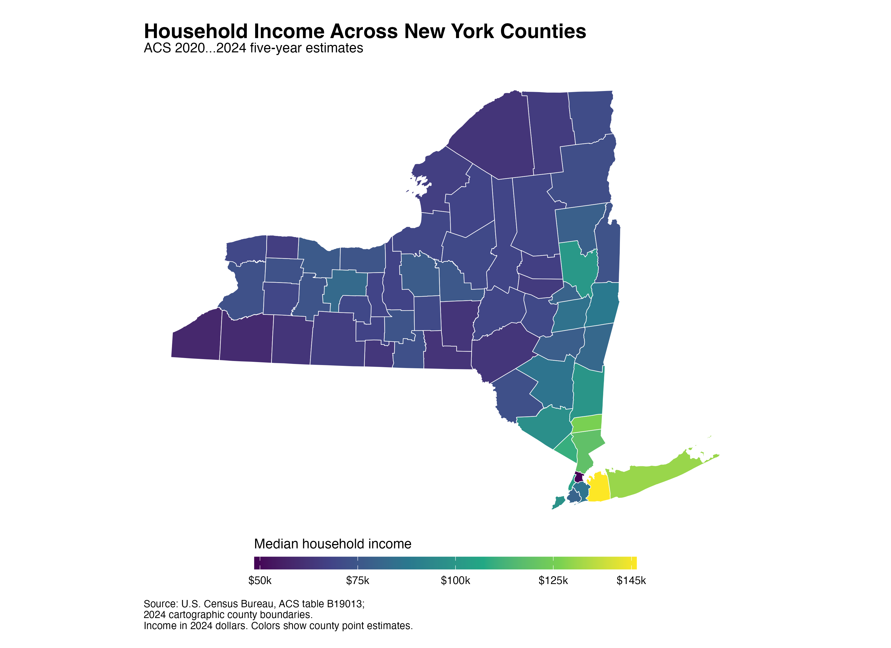
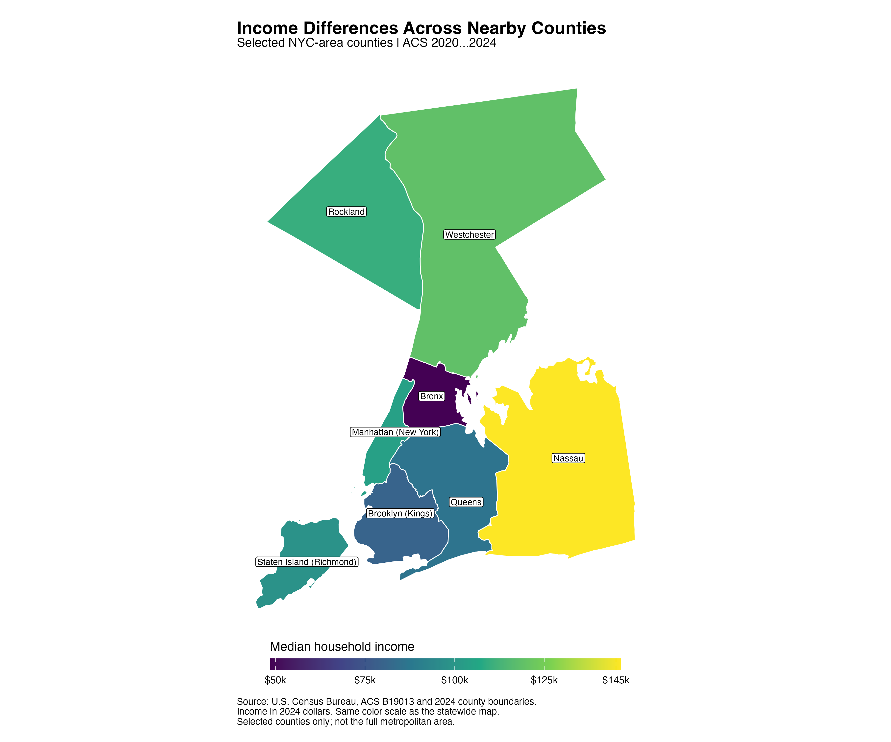
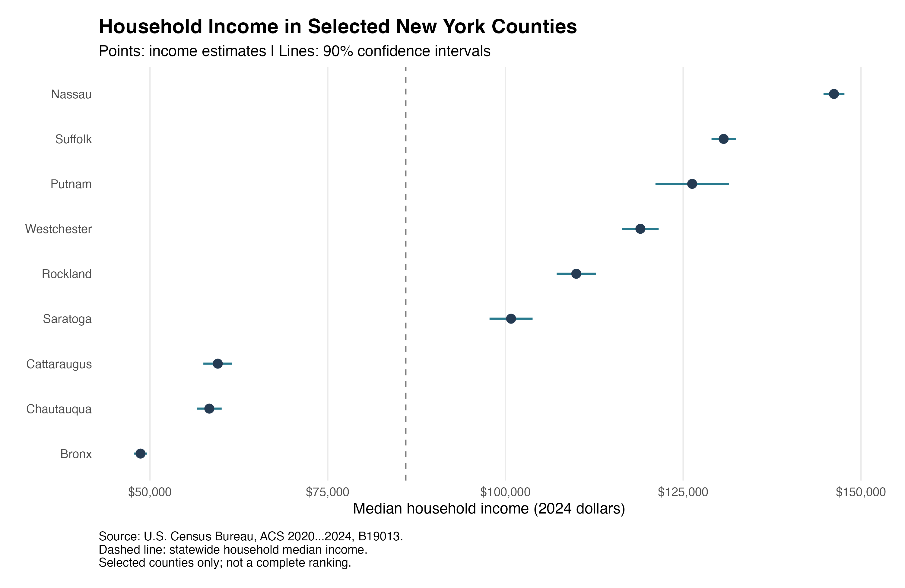

New York's statewide median household income is $85,974, but that single number hides substantial geographic differences. Where are higher- and lower-income counties concentrated, and do nearby places have similar incomes? I use county-level income estimates and geographic boundaries to examine these questions. The maps reveal a concentration of high-income counties around New York City, alongside sharp differences within that same part of the state.

## Data and approach

I use the Census Bureau's [2020–2024 American Community Survey five-year estimates, table B19013](https://data.census.gov/table/ACSDT5Y2024.B19013), which measure median household income in 2024 inflation-adjusted dollars. These are pooled five-year estimates, not observations from 2024 alone. The geographic units are New York's 62 counties, including the five counties corresponding to New York City's boroughs.

In R, I join income estimates to [2024 Census cartographic county boundaries](https://www2.census.gov/geo/tiger/GENZ2024/shp/) using five-digit county GEOIDs. All 62 counties match, with no missing income estimates. I project the boundaries into a New York coordinate system and use a continuous color scale so that the maps preserve differences in dollar values. Purple represents lower income estimates, while yellow represents higher estimates. The statewide median is taken directly from the state estimate, rather than calculated by averaging county medians.

## A concentration around New York City

The five highest county point estimates belong to Nassau ($146,202), Suffolk ($130,686), Putnam ($126,257), Westchester ($118,976), and Rockland ($109,959). These counties form a visible concentration on Long Island and north of New York City. This pattern shows that high household incomes extend beyond Manhattan into surrounding counties; they are not confined to the city's central county.

Lower estimates appear across much of western and northern New York. Chautauqua's median is $58,351, while Cattaraugus's is $59,540. However, the map is not a simple division between a wealthy southeast and a uniformly lower-income remainder. Saratoga, farther north, has an estimated median of $100,787. This exception matters: location within a broad region alone does not fully summarize a county's income position.

## Nearby counties can differ sharply

The detail map reveals a contrast that is easy to miss at statewide scale. The Bronx has the lowest county estimate, $48,676, despite bordering Westchester, one of the highest-income counties. Nassau's estimate is approximately 3.00 times the Bronx's. Geographic proximity therefore does not imply similar household incomes.

This contrast also changes how the broader map should be interpreted. Describing the New York City area as uniformly affluent would conceal a substantial difference among nearby counties. A regional summary can combine places with very different household circumstances. The map identifies where these differences occur, but it does not establish whether employment opportunities, housing markets, household composition, or other factors explain them. Those mechanisms would require additional data and analysis.

## What the maps cannot tell us

ACS estimates have sampling uncertainty. The comparison chart retains the published 90 percent margins of error; close point estimates should not be treated as certain rankings. The analysis is descriptive and does not test spatial clustering formally.

County medians also hide differences within counties. A high median does not mean every resident has a high income, and household income does not measure wealth or account for differences in household size and local living costs. Finally, large counties occupy more map space regardless of their population, so the map describes geography rather than the share of residents at each income level.

The main takeaway is that New York's income geography combines a concentration of high-income counties around New York City with substantial differences among nearby places. Understanding the statewide economy requires looking both across regions and within them.

---

[Code, data, and replication instructions](https://github.com/liyujing-byte/blogpost5_GIS_Visualization)
