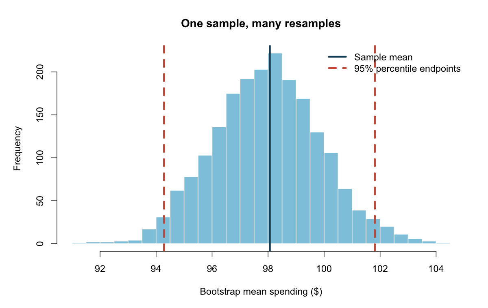
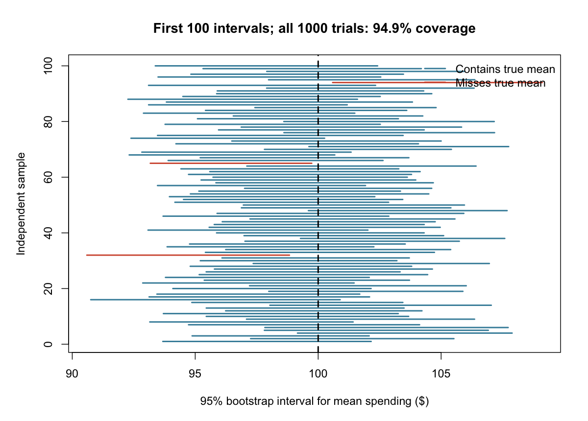
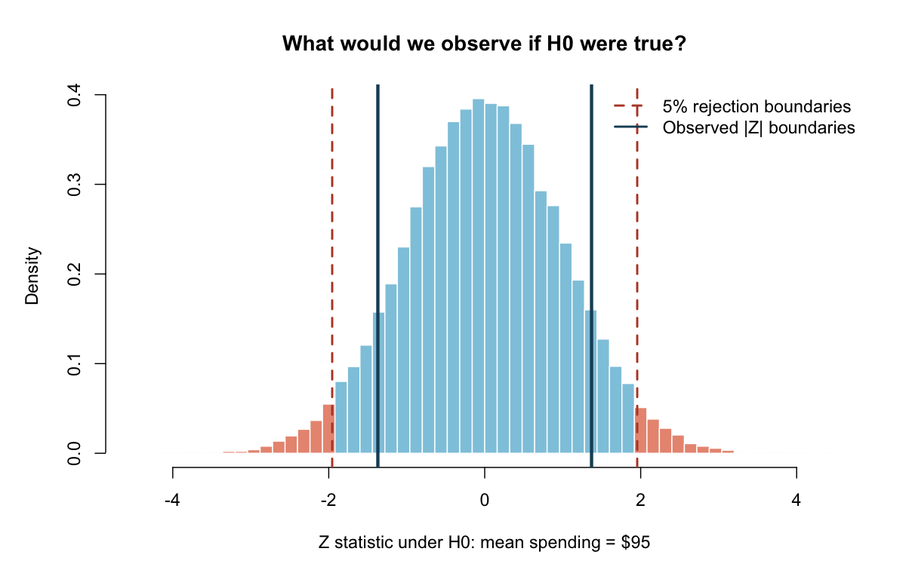

## Question and motivation

How can one small sample tell us something about a population? A sample average changes whenever we collect new observations. Statistical inference quantifies this uncertainty. Here I simulate independent household spending from a normal population with mean $100 and standard deviation $20. These numbers are assumptions for a teaching experiment, not estimates from real households. Knowing the population truth lets us check whether our methods work.

## From one sample to a bootstrap distribution

I draw 80 observations and obtain a sample mean of $98.06. To bootstrap, I draw 80 observations with replacement from this same sample, calculate their mean, and repeat 2000 times. Replacement matters: an observation can appear several times in one resample. This approximates the sampling variability of the mean using the observed data as an empirical population.

The first figure displays the resulting bootstrap distribution. Its 2.5th and 97.5th percentiles give a 95% percentile interval of [$94.28, $101.81]. The interval describes uncertainty about the population mean, not the range containing 95% of individual households. A narrow distribution means greater precision; a larger sample generally makes the distribution narrower.



## Does 95% really mean 95%?

To investigate coverage, I repeat the entire experiment 1000 times. Every repetition starts with a fresh sample from the population, constructs its own bootstrap distribution, and records whether its interval includes the fixed true mean of $100. The second figure shows the first 100 intervals; orange intervals miss the vertical truth line. Across all repetitions, coverage is 94.9%, with a Monte Carlo standard error of 0.70 percentage points.

The 95% refers to the long-run success rate of the interval procedure. After a particular interval is calculated, both endpoints are fixed, as is the population mean: the interval either contains it or does not. Observed coverage need not equal exactly 95%. Finite samples, bootstrap approximation and simulation randomness all matter. Percentile intervals can under-cover, especially for small or strongly skewed samples; this experiment does not establish a universal guarantee.



## Hypothesis testing: a world where the null is true

Now consider H0: mean spending equals $95, against a two-sided alternative. For this demonstration I treat the population standard deviation of $20 as known. The test statistic is Z = (sample mean - 95)/(20/sqrt(n)). If the standard deviation were unknown, the testing procedure would need to account for estimating it, for example through a t test under normality.

I simulate 50000 new samples under H0 to build the reference distribution. The observed statistic is 1.370. The outer 5% of absolute simulated statistics defines a two-sided rejection region, approximately |Z| > 1.956. The orange histogram tails show this rejection region. Dark lines mark the observed absolute statistic on both sides, separating outcomes at least as extreme as our observation.

The Monte Carlo p-value is 0.1718; the normal-theory value is 0.1707. The simulated calculation counts both tails and uses a plus-one correction to avoid reporting zero from a finite simulation. At the 5% level, we do not reject H0. A p-value is the probability, assuming H0 and the model, of a statistic at least this extreme. It is not the probability that H0 is true and does not measure economic importance.



## Try it and takeaway

Use the interactive lab below to vary sample size and confidence level. Its seeded normal-population experiment recomputes bootstrap distributions and repeated-sample coverage in your browser. Compare interval width and coverage across settings; small simulation counts add visible noise. The R analysis remains the reproducible source for the reported figures and tables.

Bootstrap intervals quantify estimation uncertainty; null simulations calibrate tests. Both rely on a sampling model and repeated experiments. Independence and representative sampling are substantive assumptions: repeating a biased sampling process cannot repair it.

## Data and reproducibility

All observations are synthetic and generated with base R using seed 640008. Run source('code/blogpost8_all_process.R') from the project root. See README.md for outputs and assumptions. No external dataset or additional R package is required.


[Complete R code, data, and replication evidence](https://github.com/liyujing-byte/blogpost8_statistical_inference)


```{=html}
<iframe src="interactive.html" title="Interactive bootstrap inference lab" style="width:100%;height:1050px;border:1px solid #dde4e9;"></iframe>
```

[Open the interactive lab](interactive.html)
